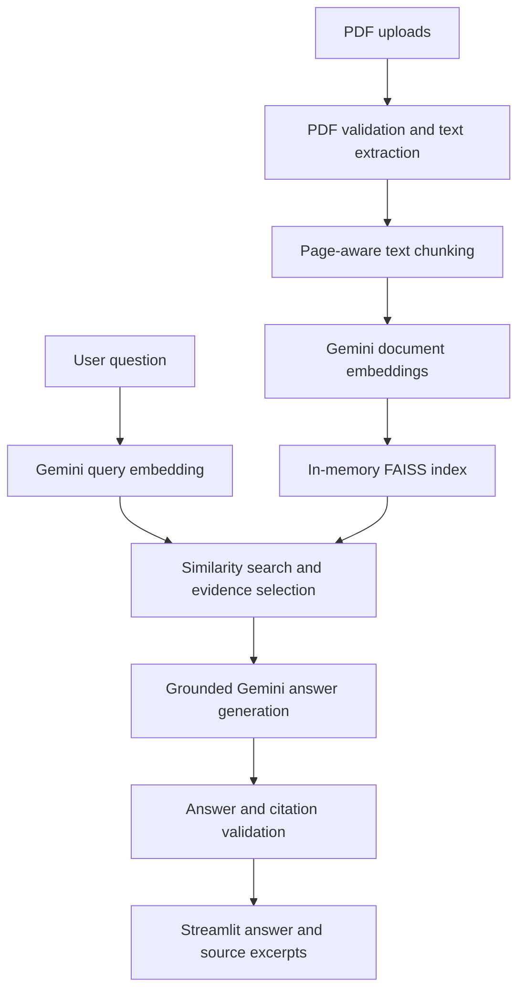

# PDF RAG Question Answering System

A local, single-user application that answers questions from uploaded, text-based PDFs using **retrieval-augmented generation (RAG)**. It combines **Google Gemini**, **LangChain**, **FAISS**, and **Streamlit**, and displays the source passages used to support each answer.

The application is designed around separate domain, application, infrastructure, and presentation layers, with typed contracts and automated tests.

## Features

- Upload and index multiple text-selectable PDF documents.
- Extract page-aware text and split it into overlapping chunks.
- Generate Gemini embeddings and search a FAISS vector index using cosine similarity.
- Retrieve relevant passages before generating a PDF-grounded answer.
- Display source citations with the PDF filename, page number, chunk ID, and excerpt.
- Abstain when the retrieved evidence is insufficient instead of inventing an answer.
- Handle invalid PDFs, malformed answers, and API rate-limit errors with user-facing messages.
- Maintain documents, index, and chat history within the current Streamlit session.
- Run offline automated tests without a Gemini API key.

## Architecture



**Layer responsibilities**

| Layer | Location | Responsibility |
| --- | --- | --- |
| Domain | `src/pdf_rag/domain/` | Typed models, identifiers, domain errors |
| Application | `src/pdf_rag/application/` | Policies, ports, retrieval orchestration, evidence grounding |
| Infrastructure | `src/pdf_rag/infrastructure/` | PDF extraction, Gemini adapters, FAISS vector storage |
| Presentation | `src/pdf_rag/presentation/` | Streamlit upload, indexing, question-answering, and citations |
| Composition | `app.py` | Wires application services for each Streamlit session |

## Technology stack

- **Language:** Python 3.11+
- **UI:** Streamlit
- **LLM and embeddings:** Google Gemini through `langchain-google-genai`
- **Text splitting and prompts:** LangChain
- **Vector search:** FAISS with normalized 768-dimensional embeddings
- **PDF extraction:** pypdf
- **Schemas and validation:** Pydantic
- **Tests:** pytest and pytest-mock

The current application configuration uses `gemini-embedding-2` for embeddings and `gemini-3.8-flash` for generation. Availability and quotas depend on your Google API project.

## Quick start

### 1. Clone the repository

```bash
git clone https://github.com/Nishanthx7/pdf_rag_step5_phase4.git
cd pdf_rag_step5_phase4
```

### 2. Create a Python environment

On Windows (PowerShell):

```powershell
python -m venv .venv
.\.venv\Scripts\Activate.ps1
```

On macOS/Linux:

```bash
python3 -m venv .venv
source .venv/bin/activate
```

### 3. Install dependencies

```bash
python -m pip install -r requirements-phase4.txt
python -m pip install -e . --no-deps
```

### 4. Configure Gemini

Create a `.env` file in the project root using `.env.example` as the template:

```dotenv
GOOGLE_API_KEY=your_actual_google_gemini_api_key
```

Never commit `.env` or publish your API key. **A Gemini API key is required to index PDFs and answer questions**; offline tests do not require one.

### 5. Launch the application

```bash
python -m streamlit run app.py
```

Open the local URL displayed by Streamlit, typically `http://localhost:8501`. Upload one or more text-based PDFs and ask a question about their contents.

## Running tests

Run the full test suite from the repository root:

```bash
python -m pytest -q
```

The suite covers PDF ingestion, domain contracts, embeddings, vector management, retrieval, grounding, citation validation, and Streamlit session behavior. Most tests use deterministic fakes or mocks; passing them does **not** by itself confirm live Gemini API availability.

## Current scope and limitations

| Area | Current behavior |
| --- | --- |
| PDF input | Text-selectable PDFs only; no OCR for scanned documents |
| Upload limits | Up to 10 files, 20 MB per file, 100 MB total, and 300 pages total |
| Retrieval | Top 5 chunks with a configurable similarity threshold (default `0.70`) |
| Document storage | In-memory, per Streamlit session; not persisted across server restarts |
| Conversation | Questions are independent; previous messages are not included as model context |
| API usage | Google Gemini quotas and rate limits apply |
| Deployment | Local single-user development application; not production hardened |

**Privacy:** Uploaded PDF text and questions are transmitted to Google's Gemini services for embeddings and answer generation. Do not upload confidential or sensitive documents unless you have reviewed the relevant data-handling terms.

The application includes paced document-embedding batches and bounded retries for some transient API errors. These measures do not bypass daily quotas. Retrieval quality can also vary by document and question phrasing.

## Repository documentation

Detailed implementation notes from each development phase are available in:

- [`PHASE1_README.md`](PHASE1_README.md): PDF ingestion and text processing
- [`PHASE2_README.md`](PHASE2_README.md): Gemini embeddings and FAISS indexing
- [`PHASE3_README.md`](PHASE3_README.md): Grounded answer generation and citation validation
- [`PHASE4_README.md`](PHASE4_README.md): Streamlit interface and session management

These files preserve development-phase notes; **use this root README for the current installation flow**.

## Planned improvements

- Evaluate retrieval quality using an answerable/unanswerable question set.
- Improve quota-aware handling of generation requests.
- Add optional FAISS index persistence to avoid repeated embeddings.
- Add GitHub Actions for automated regression tests.
- Add screenshots and a short product demonstration.

---

**Project status:** Working local prototype with automated tests; ongoing evaluation and improvements.
